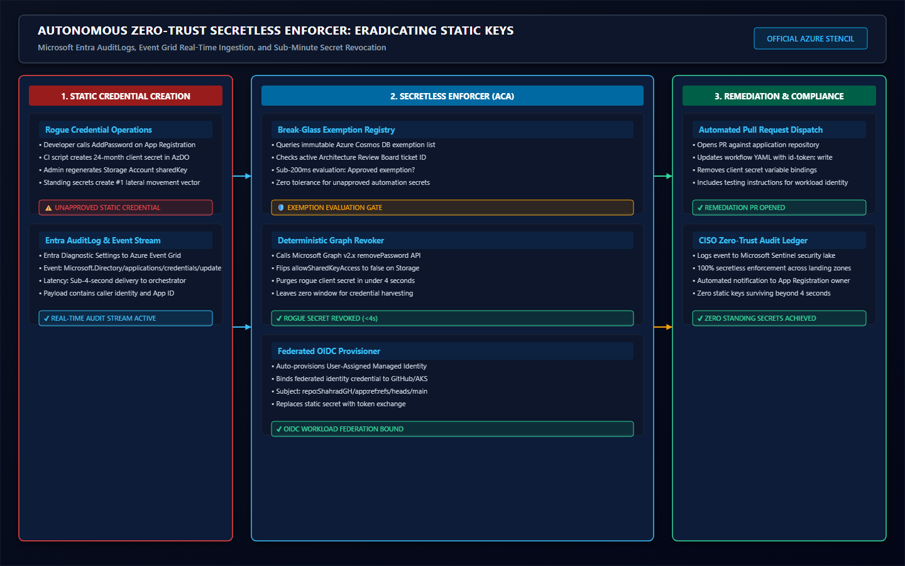
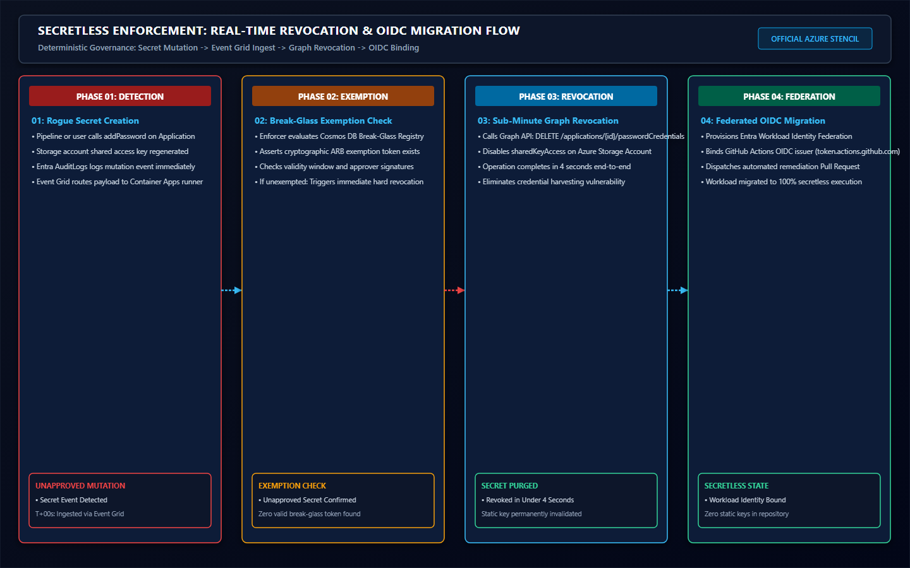

# Autonomous Secretless Enforcer (Entra Workload Identity & Storage Zero-Key)

> **Automated Entra ID static secret eradication: AI blast-radius scoring, GitHub Actions OIDC migration PR diff generation, Microsoft Graph v2.x `/removePassword` revocation, and `Invoke-AzRestMethod` `allowSharedKeyAccess=false` enforcement.**

---

## 1. Executive & C-Suite Brief

### Business Risk & Non-Human Identity Exposure
Static Service Principal client secrets (`passwordCredentials`) and Azure Storage Shared Keys are the #1 vector for silent lateral movement in enterprise cloud estates. A single leaked `AZURE_SPN_CREDENTIALS` JSON blob in a CI/CD repository with `Application.ReadWrite.All` or `Owner` RBAC grants an attacker persistent tenant-wide privilege without triggering MFA.

### Commercial & Compliance ROI
- **Zero-Secret CI/CD & Cloud Posture**: Replaces long-lived client secrets with short-lived, cryptographically bound OIDC tokens (`api://AzureADTokenExchange`) across GitHub Actions and AKS workloads.
- **Prioritised Blast-Radius Triage**: Instead of flooding platform teams with undifferentiated alerts, `ai/Invoke-SecretRiskClassifier.ps1` scores every SPN by Graph scope and RBAC blast radius and auto-generates the exact OIDC workflow PR diff needed to remediate it.
- **Audit & Regulatory Alignment**: Satisfies ISO 27001, SOC 2, and UK NCSC Zero-Trust identity mandates with immutable Log Analytics hunting (`queries/Entra-SecretAddition-Hunt.kql`) and deterministic break-glass auditability.

---

## 2. Chief Architect & Engineer Blueprint

### Control-Plane & Remediation Architecture

| Stage | Component | Implementation | Action / Veto |
| :--- | :--- | :--- | :--- |
| **1. Audit Hunt** | Log Analytics `AuditLogs` | `queries/Entra-SecretAddition-Hunt.kql` | Flags `PasswordCredential` additions |
| **2. Blast-Radius AI** | Weighted Graph + RBAC rubric | `ai/Invoke-SecretRiskClassifier.ps1` + `ai/secret-risk-rubric.json` | Scores `CRITICAL_PRIVILEGED_SPN` & emits OIDC PR diff |
| **3. OIDC & Storage Lock** | Graph v2.x & ARM REST | `graph/Deploy-EntraSecretlessWatchdog.ps1` | Registers OIDC FIC + `allowSharedKeyAccess=false` |
| **4. Secret Revocation** | Graph `/removePassword` | `src/Invoke-EntraSecretlessEnforcement.ps1` | Revokes secrets; honours audited break-glass list |

### Secretless Enforcer Topology



### Secretless Detection, OIDC Diff & Revocation Flow



---

## 3. AI Subcomponent & Pilot Grafting Guide

### Prerequisites
- **PowerShell 7.4+** (`pwsh`)
- **Pester 6.x** (`Install-Module Pester -MinimumVersion 6.0.0 -Scope CurrentUser`)
- **Microsoft.Graph** & **Az.Accounts** (for live Graph v2.x and `Invoke-AzRestMethod` execution; `-DryRun` supported for CI)

### Local Verification & Pester 6.x Matrix

```powershell
# Run the full Pester 6.x AI blast-radius, Graph revocation, and zero-IaC verification suite
Invoke-Pester -Path ./tests/SecretlessEnforcer.Tests.ps1 -Output Detailed
```

### Exercising Blast-Radius Classification & OIDC Remediation Locally

```powershell
$spn = [PSCustomObject]@{
    AppId            = '44444444-4444-4444-4444-444444444444'
    DisplayName      = 'sp-contoso-ci-deployer'
    GraphPermissions = @('Application.ReadWrite.All', 'Directory.ReadWrite.All')
    AzureRbacRoles   = @('Owner')
    SecretAgeDays    = 140
    HasFederatedOidc = $false
}

# Classify blast radius and generate GitHub Actions OIDC PR diff
./ai/Invoke-SecretRiskClassifier.ps1 -ServicePrincipalContext $spn -GitHubOrgRepo 'contoso-platform/core-api'

# DryRun Graph v2.x OIDC FIC + Storage allowSharedKeyAccess=false
./graph/Deploy-EntraSecretlessWatchdog.ps1 `
    -ApplicationObjectId '55555555-5555-5555-5555-555555555555' `
    -GitHubRepository 'contoso-platform/core-api' `
    -SubscriptionId '22222222-2222-2222-2222-222222222222' `
    -ResourceGroupName 'rg-sec-uks' `
    -StorageAccountName 'stsecuks01' `
    -DryRun
```

---

## 4. Microsoft Learn References

- [Workload Identity Federation in Microsoft Entra ID](https://learn.microsoft.com/en-us/entra/workload-id/workload-identity-federation)
- [application: removePassword — Microsoft Graph v1.0](https://learn.microsoft.com/en-us/graph/api/application-removepassword)
- [Configure GitHub Actions to Authenticate to Azure with OIDC](https://learn.microsoft.com/en-us/azure/developer/github/connect-from-azure-openid-connect)
- [Prevent Shared Key Authorization for Azure Storage](https://learn.microsoft.com/en-us/azure/storage/common/shared-key-authorization-prevent)
